# System Architecture & Technical Specification

## 1. Architectural Philosophy
TradeWise India follows a **Modular Monolith** architecture designed for institutional credibility, deterministic financial calculation integrity, strict separation of concerns, and regulatory compliance.

The platform deliberately decouples the **financial calculation engine** from the **AI / LLM layer** to ensure that all financial formulas, backtest steps, position sizes, and taxes are mathematically verifiable, transparent, and auditable.

---

## 2. Component Topology

```mermaid
flowchart TD
    subgraph Presentation_Layer ["Presentation Tier (React 18 + TS + Vite)"]
        UI_Nav["App Shell & Navigation (Dark/Light)"]
        UI_Overview["Overview Dashboard"]
        UI_Markets["Market Intelligence & Candlestick Engine"]
        UI_Academy["Trading Academy & Quiz Engine"]
        UI_Strategy["Strategy Lab & Backtest Visualizer"]
        UI_Paper["Paper Trading & Execution Journal"]
        UI_Risk["Risk Studio & Stress Tester"]
        UI_AI["AI Finance Tutor (Grounded RAG)"]
        UI_Research["Saved Research & Trading Notes"]
    end

    subgraph API_Gateway ["API Gateway & Core Application (FastAPI + Pydantic v2)"]
        Auth_MW["Auth & Bearer Token Middleware"]
        CORS_MW["CORS & Security Headers Middleware"]
        API_V1["/api/v1 Router (Versioned Endpoints)"]
    end

    subgraph Domain_Services ["Deterministic Domain Services"]
        Svc_Market["MarketDataProvider (Adapter Interface)"]
        Svc_Quant["Quantitative Indicators (SMA, EMA, RSI, ATR)"]
        Svc_Backtest["Backtesting Engine (Chronological, Indian Taxes)"]
        Svc_Paper["Paper Execution Engine (Mark-to-Market PnL)"]
        Svc_Risk["Risk Engine (Position Sizing & Recovery Models)"]
        Svc_Tutor["AI Tutor Service (SEBI/NSE Grounded RAG)"]
    end

    subgraph Data_Tier ["Persistence & Corpus"]
        DB[(SQLAlchemy Relational Store: SQLite / PostgreSQL)]
        Corpus[(Vetted Indian Regulatory & Academic Literature)]
    end

    Presentation_Layer -->|JSON / REST| API_Gateway
    API_Gateway --> Domain_Services
    Domain_Services --> Data_Tier
```

---

## 3. Technology Stack Justification

| Layer | Selection | Justification |
| :--- | :--- | :--- |
| **Frontend Framework** | React 18 + Vite + TypeScript | Type safety, zero-lag rendering for financial data tables, hot module reloading. |
| **Styling** | Tailwind CSS | Institutional color tokens (`#0B1220`, `#111C2E`, `#2DD4BF`), high-contrast dark and light modes, zero CSS bloat. |
| **Backend Framework** | FastAPI (Python 3.13) | Asynchronous request processing, native Pydantic v2 validation, automated OpenAPI docs. |
| **ORM & Database** | SQLAlchemy 2.0 | Vendor-independent ORM supporting SQLite for local dev/testing and PostgreSQL for production. |
| **Quantitative Math** | NumPy, SciPy, Pandas | Standard vector operations, statistical evaluation of return distributions, Sharpe/Sortino ratios. |
| **Security** | Salted PBKDF2-HMAC-SHA256 & JWT | Cryptographically robust password hashing and stateless token authorization. |
