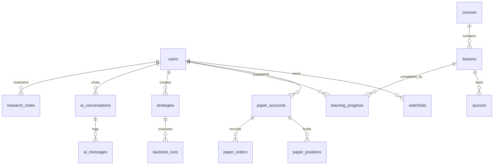

# Database Schema & Relational Specifications

## 1. Schema Overview
The database schema separates market data, educational curriculum, user preferences, and private simulation state into relational entities.

---

## 2. Table Specifications

### `users`
- `id`: Primary key (Integer).
- `email`: Unique email (String 255, indexed).
- `hashed_password`: Salted PBKDF2 hash (String 255).
- `full_name`: User's display name (String 255).
- `role`: Role permissions (`student`, `trader`, `quant`, `admin`).
- `is_active`, `is_verified`: Boolean status flags.
- `created_at`: Timestamp.

### `instruments`
- `id`: Primary key (Integer).
- `symbol`: Unique ticker (e.g., `NIFTY50`, `RELIANCE`, `TCS`).
- `name`: Full legal name of instrument.
- `exchange`: `NSE` or `BSE`.
- `segment`: `INDEX`, `EQUITY`, `COMMODITY`.
- `sector`: Industrial sector classification.
- `tick_size`, `lot_size`: Market trading micro-specifications.
- `last_price`, `change`, `change_pct`, `volume`: Price metrics.

### `courses`, `lessons`, `quizzes`
- `courses`: Curriculum tracks (`beginner`, `intermediate`, `advanced`) with hours, difficulty, and order.
- `lessons`: Educational content in markdown, duration minutes, and learning objectives list.
- `quizzes`: Question string, options JSON list, correct option index, and detailed conceptual explanation.

### `strategies` & `backtest_runs`
- `strategies`: User defined rules (`strategy_type`, JSON parameters).
- `backtest_runs`: Chronological performance output (`total_return_pct`, `cagr_pct`, `max_drawdown_pct`, `sharpe_ratio`, `sortino_ratio`, `win_rate_pct`, `profit_factor`, `equity_curve` JSON, `trades_log` JSON).

### `paper_accounts`, `paper_positions`, `paper_orders`
- `paper_accounts`: Virtual cash balance, initial balance, realized PnL.
- `paper_positions`: Active holdings, quantity, average entry price, current price, unrealized PnL.
- `paper_orders`: Order side (`BUY`, `SELL`), order type (`MARKET`), quantity, fill price, estimated regulatory fees, status, execution timestamp.
